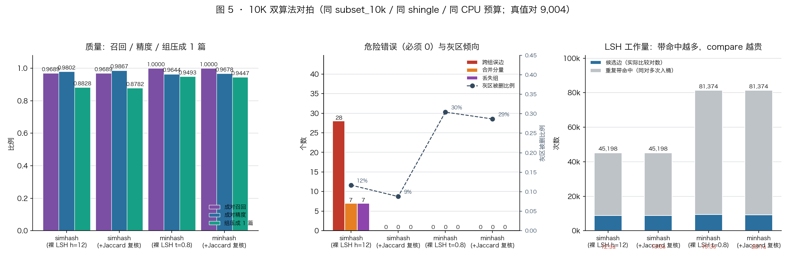
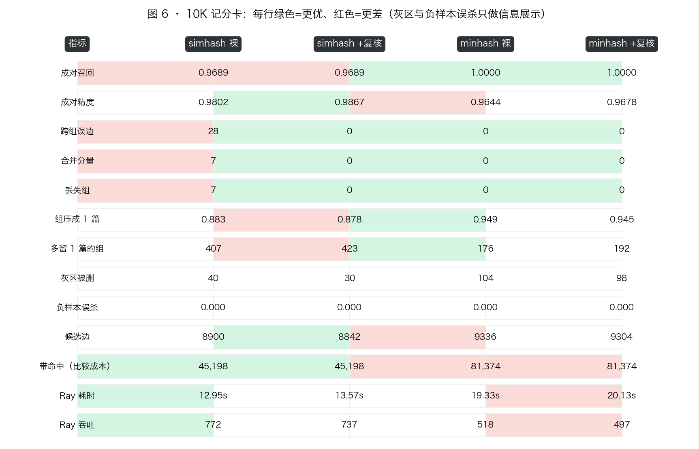

# 结果：Ray 文本去重实验（node1）

| 阶段 | 数据 | 关键配置 | 结论一句话 |
|---|---|---|---|
| [A](#阶段-a--simhash-1k-冒烟2026-11-10-1505run-20261110-150517) | 1K | 128bit / 8×16bit / hamming 12 / verify 0 | ray ≡ local，19 项指标逐项相等；召回 0.968、精度 0.979 |
| [B](#阶段-b--simhash-10k--lancedb-输入输出2026-11-10-15251533) | 10K | 同上 + LanceDB 进/出 | Ray 首次快于单机（2.2×）；hamming=12 在 10K 出现 28 条跨组误边，`verify=0.8` 清成 0 |
| [C](#阶段-c--minhash-流水线1k-验证--10k2026-11-10-16191628) | 1K + 10K | k=128 / 12×10 / t=0.8 | 召回 **1.0**（9004/9004）、组压成 1 篇 94.9%、裸跑 0 跨组误判；单机快 8.8×，Ray 10K 反而慢 1.5× |
| [D](#阶段-d--10k-双算法对拍2026-11-10-16421644) | 10K | 2 算法 × 2 口径（裸 LSH / +复核），背靠背 4 个 run | 裸 LSH：minhash 召回 1.0、simhash 0.9689（28 条跨组误边需复核兜底）；成本 simhash 12.95s vs minhash 19.33s |
| [E](#阶段-e--外推到-600m2026-11-10-1650纯分析无集群作业) | 分析 | 1K/10K 实测 + 校准分布 → 600M 外推 | **simhash 的 10K 优势到 600M 不成立**：定宽分带 λ=9,155、噪声对 2.2e13；minhash 与 N 无关 |

---

# 阶段 A — simhash 1K 冒烟（2026-11-10 15:05，run 20261110-150517）

配置：node1 Ray 2.60 / 22 CPU，`bits=128`（8 带 × 16bit），`hamming=12`，`shingle=3`，
`verify=0`（不做 Jaccard 后处理，只看 LSH 本身），`mode=both`（Ray + 单机对拍）。
语料：`/tmp/raytest/corpus/corpus_200k.jsonl` 前 1002 篇（按整组取，sha256 `53518f48edf7…`）。

## 1. 指标（ray 与 local 完全一致）

| 指标 | 值 | 含义 |
|---|---|---|
| docs / chars | 1002 / 30.7 万 | 347 个组（338 个 base 组 + 9 篇 neg） |
| **pair_recall** | **0.9683**（854/882） | 同组文档对被 LSH 召回的比率 |
| **pair_precision** | **0.9794**（854/872） | 候选边里真同组的比率 |
| edge_fp_cross_base | **0** | 跨组误判的边（最危险的一类）一条都没有 |
| edge_fp_border | 18 | 命中的边里有一方是 border（灰区，不算错） |
| groups_missing | **0** | 没有任何组被整体删光 |
| groups_extra_kept | 50 / 347 | 85.6% 的组被正确压成 1 篇，50 组多留了 1 篇 |
| components_merged | **0** | 没有出现跨组合并的连通分量 |
| neg_false_drop_rate | **0**（0/9） | 硬负样本零误杀 |
| border_dropped | 3 / 45 | 灰区被删 6.7% |
| kept / dropped | 397 / 605 | — |
| edge_total / band_hits | 872 / 4454 | 去重后的候选对 / 分带命中次数（一对可能命中多个带，5.1×） |
| 端到端 | ray 5.95s（168 docs/s）· local 2.86s（350 docs/s） | 1K 下 Ray 慢 2 倍，全是 actor 启动 + shuffle 固定开销 |

## 2. 判读

- **正确性**：Ray 分布式结果与单机串行结果在 19 个指标上逐项相等，说明切带/分桶/并查集语义没问题；
  面板 5 个阶段全部点亮，`result.json` 落盘，页面最终状态为「已完成 / 100%」。
- **质量**：在 1K 上 LSH 成对召回 96.8%、精度 97.9%，跨组误判为 0，负样本零误杀。
  86% 的组被压成 1 篇，剩下 14% 是「组内某条边没被召回」而非误合并。
- **性能**：1K 太小，Ray 的 22 个并发用不满（只有 8 个 batch 可切），吞吐数字不能用来比较算法，
  只证明流水线跑得通、不卡死。吞吐对比放到 10K/100K。

## 3. 这一轮修掉的三个坑（都有实测证据）

1. **三个 actor pool 各要满额 CPU → 卡死在 compare 阶段**
   每个 `map_batches` 都开 `ActorPoolStrategy(size=22)`，三个 stage 要 66 个 CPU，下游 pool 永远等不到
   资源：现象是面板停在 fingerprint 728/1002、`ray.status` 显示 22/22 CPU 被占、但实际上 0 个 running task。
   改成把集群切成互不重叠的三份预算（10 / 5 / 5，留 2 个 CPU 给复核任务），1K 从「永久卡住」变成 6s 跑完。
2. **分布式指纹的位序和单机实现不一致**
   `fingerprints()` 把 128bit 的高位块拼在前，等于对指纹做了 64bit 半区换位：汉明距离不变，
   但分带用的 16bit 片段全变了，等于偷偷换了一套 LSH 参数（还会让校准表失效）。
   修完 numpy 版与 `simhash.simhash()` 在 1000 篇上 1000/1000 逐位相等。
3. **按文件前缀取子集会把同组文档切散**
   语料生成时整体洗牌过，取前 1000 行只包含 973 个不同的 base（几乎每组只剩 1 篇），
   子集里根本没有完整重复对，recall 恒为 0。改成按整组取样（两遍扫描），1K → 338 个完整组。

## 4. 指标口径说明

早期版本用「dup 是否被删」当召回，同一份结果算出 0.62，而真实成对召回是 0.97 —— 差别来自
代表文档取「分量内最小 doc_id」：`orig` 常常不是最小 id，于是组被正确压成 1 篇时，
幸存者仍可能是 near/exact，那个指标就把「谁活下来」误当成「有没有召回」。
所以现在按两个口径报：成对（`pair_recall` / `pair_precision`）+ 组（`groups_*` / `components_merged`）。

## 5. 下一步

1. ~~10K 规模 + LanceDB 输入/输出~~ → 阶段 B 已完成（见下文）；
2. minhash 落地：`minhash.py` + 复用同一条 5 阶段流水线（同一 shingle、同一 union-find、同一 seed），
   与 10K 的 simhash 四个 run 逐项对照；
3. 阶段 C：100K（`subset_100k` 同样由 LanceDB 物化），看候选对增长与 Ray 并行效率；
4. 可选：`near_ratio=0.005` 轻改写通道，验证「hamming=12 在真实语料上是否同样偏松」；
5. 监控页改成双算法（simhash / minhash 阶段词表、参数卡、历史 run 对比），`algo` 维度已写进
   `progress.json` / `result.json` / LanceDB 三张表，页面侧单独进行。

原始产物：`results/phaseA_simhash_1k.json`（指标）、`results/phaseA_simhash_1k.log`（driver 日志）。

## 6. 面板已知的展示局限

- 「任务分配」的 worker 行来自各 actor 自己写的文件，Ray Data 会在阶段切换时回收/重建 actor，
  所以一行的 docs/batches 只是该 actor 存活期间处理过的量（本次指纹阶段只留下 5 个 actor、640 篇的记录，
  而真实处理量是 1002 篇）。阶段总计与总进度走 `progress.json`，是准确的。
- 1K 端到端只有 6 秒，页面 1s 一帧很容易只看到首尾两帧；实时观察要等 10K/100K。

---

# 阶段 B — simhash 10K + LanceDB 输入/输出（2026-11-10 15:25–15:33）

配置：node1 Ray 2.60 / 22 CPU，`bits=128`（8 带 × 16bit），`shingle=3`，`seed=7`；
数据 = 固定快照的**整组子集** `subset_10k`：**10,002 篇 / 3.06M 字 / 3,472 组**
（3,372 orig + 3,372 exact + 2,816 near + 342 border + 100 neg）；
`corpus_sha256 = 53518f48edf7…`（与 manifest 一致），`subset doc_ids_sha256 = 1d7dd46eddd6…`。

## 1. 数据进出的实现（本轮新增）

输入输出都改成 LanceDB，语料快照本身仍然只生成一次（铁律不变）。

```
/tmp/raytest/lance/
├── corpus.lance        199,998 行 / 61.3M 字    ← jsonl 快照一次性入库（1.7s）
├── subset_1k.lance     1,002 行（347 组）
├── subset_10k.lance    10,002 行（3,472 组，本轮实际输入）
├── catalog.lance       corpus/subset 的来源、sha256、doc_ids_sha256、组数、kinds
├── dedup_result.lance  run_id, mode, doc_id, base_id, kind, kept, rep_id（逐篇）
├── dedup_edges.lance   run_id, mode, a, b（候选边）
└── dedup_runs.lance    run_id, mode, 配置 + 19 个指标列 + metrics_json（按 run 累积）
```

- **入库**（`lancedb_io.py --ingest`）：按 manifest 的口径重算 sha256 并断言相等，
  再写 `catalog`；同一份语料之后任何实验都只读表，不再读 jsonl。
- **取子集**（`--materialize N`）：按「整组」选组（与 `corpus_io.load_corpus` 同语义），
  物化成 `subset_<n>` 表。本轮 1K/10K 两档都与 jsonl 路径**逐 doc_id 相等**（10,002 vs 10,002，
  逐篇文本 md5 也 0 差异），所以 1K ⊂ 10K ⊂ jsonl 快照这三条路径是同一批字节。
- **Ray 侧输入**：`ray.data.read_lance("…/subset_10k.lance")` 直接分布式扫描 Lance 数据集，
  不再把 10,002 篇文本 pickle 进 driver 参数；流水线里先校验「读到 10,002 行 == 子集篇数」。
- **结果回写**：`write_results()` 写三张表（0.04s，20,004 行 result + 17,800 行 edge），
  随后 `verify_results()` 从表里回读：`ray_vs_local_kept_diff = 0`、`rep_id` 差异 0，
  `count_rows(run_id=… AND mode='ray' AND kept)` = 3,872 与报告一致。
- **诊断/重建报告**：`analyze_run.py --run-id …` 直接从表里出「跨组分量的成员、跨组边的 Jaccard、
  按 kind 的 kept 统计」；`--export-report` 用 `dedup_runs` 把整份报告重建出来（本轮 4 个 run 的
  json 都是这样重建的，证明输出表够用）。

## 2. 四个 run 的指标（同一子集，只改阈值/复核）

| run_id | hamming | verify | 候选边 | pair_recall | pair_precision | 跨组误边 | 合并分量 | 丢失组 | kept | ray 耗时 | 吞吐 |
|---|---|---|---|---|---|---|---|---|---|---|---|
| `phaseB_simhash_10k_lance` | 12 | 0 | 8,900 | **0.9689** | 0.9802 | **28** | 7 | 7 | 3,872 | 12.55s | 797/s |
| `phaseB_simhash_10k_verify08` | 12 | 0.8 | 8,842 | 0.9689 | **0.9867** | **0** | 0 | 0 | 3,895 | 13.39s | 747/s |
| `phaseB_simhash_10k_k10` | 10 | 0 | 8,364 | 0.9205 | 0.9909 | 0 | 0 | 0 | 4,134 | 12.66s | 790/s |
| `phaseB_simhash_10k_k8` | 8 | 0 | 7,316 | 0.8101 | 0.9970 | 0 | 0 | 0 | 4,658 | 12.73s | 786/s |

统一口径：真值对 9,004 对；`neg_false_drop_rate = 0`（四个 run 都是 0/100）；
`band_hits` 45,198 / 45,198 / 44,260 / 41,914（一对平均命中 5.1–5.7 个带）；
灰区 `border_dropped / 342` = 40 / 30 / 23 / 6。

> 单机基线与 Ray 在 hamming=12 的 run 上 **19 项指标逐项相等**（含 28 条跨组误边、7 个合并分量），
> 说明这批数字是算法本身的行为，不是分布式的锅。local 28.13s / 355.6 docs/s。

## 3. 判读

1. **规模效应：Ray 第一次跑赢单机。** 同一配置下 ray 12.55s（797 docs/s）vs local 28.13s（356 docs/s），
   比值从 1K 的 0.46 变成 2.24；数据量 ×10，Ray 只多花 2.1 倍时间（1K 6.0s → 10K 12.6s），
   固定开销（actor 启动 + shuffle）在 10K 被摊薄，指纹阶段才真正吃满 10 个 actor。
2. **1K 的「跨组误边 = 0」是规模不够，不是阈值安全。** 10K 上 hamming=12 出现 28 条跨组边、
   7 个连通分量跨组串味、7 个组整体消失（`groups_missing = 7`）。逐条查表（`analyze_run.py`）：
   28 条边的 shingle Jaccard 只有 0.286–0.416（p50 0.365），汉明距离**全部正好等于 12**，
   端点组合 orig-exact 7 / orig-orig 6 / exact-exact 6 / exact-orig 5 —— 都是「同 8 个模板、15 个主题词」
   拼出来的不同 base 组，属于模板语料里的天然相似对。1K 只有 9 篇 neg、338 组，这种对撞不够多，
   所以当时看起来是 0。
3. **`verify=0.8` 是最省事的修法**：把 8,900 条候选边里 58 条（28 跨组 + 30 灰区）剔掉，
   召回一点不掉（0.9689）、精度 0.9802 → 0.9867，合并分量/丢失组归 0，代价只有 0.8s（13.39s vs 12.55s）。
4. **只降阈值也能归零，但更贵**：hamming=10 召回 0.9205（掉 4.8 个点）、hamming=8 召回 0.8101（掉 16 个点），
   而「分组被压成 1 篇」的比例从 0.883 掉到 0.809 / 0.658。也就是说在 10K 这个语料上，
   **12 bit + Jaccard 复核** 明显优于 **10 bit 裸 LSH**：精度相当，召回高 5 个点。
5. 灰区（border）随阈值单调变化：40 → 30 → 23 → 6，符合「阈值越松灰区越容易被判重」的预期，
   但它不是错误，只看趋势，不参与 pass/fail。

## 4. 这一轮修掉/踩到的三个坑

1. **语料摘要口径不一致**：`corpus_io.dump_corpus` 的 sha256 是对「每行去掉换行」累加的，
   按原始文件字节算会得到另一个值（`9ee7d487…`）。入库时按 manifest 口径重算并断言相等
   （`53518f48…`），否则报告里的 `corpus_sha256` 会和历史结果对不上。
2. **`verify>0` 的代码路径从来没被跑过，一跑就炸**：`_verify_pairs` 里对 Ray 已自动解引用的参数
   又做了一次 `ray.get()` → `ValueError: Invalid type of object refs`，作业 failed。
   修掉后 8,900 条边复核 0.8s。
3. **失败的作业会打印上一轮的 result.json**：第一版 `run_experiment.sh` 在 `failed` 时照样打印
   指标，看起来像本轮结果（实测把上一轮 12.55s 的数字当成了 verify 轮的结果）。
   现在检测到 failed/stopped 就打 driver 日志尾部并 `exit 1`；另外每次 run 都留一份
   `/tmp/raytest/runs/<run_id>.json`，不再只有一个 `/tmp/raytest/result.json`。

## 5. 可复现凭据

```
corpus_sha256      = 53518f48edf75cd3898aca835ea710bf19ba513ff639d0685f6caf5333638940
subset_table       = subset_10k（10,002 篇 / 3,472 组 / 3,057,514 字）
subset_sha256      = 1d7dd46eddd6fb396b51708c05a82df2fb4af2867c66ba9fd3c17662e36fb6b2
bits / band_bits   = 128 / 16（8 带）
shingle / seed     = 3 / 7
verify             = 0（run 1/3/4）、0.8（run 2）
ray / lancedb      = 2.60.0 / 0.41.0（pylance 14.0.2 供 ray.data.read_lance）
job ids            = sp4AgMX3rhqHvY8P, sFFMYyD8DTsCkjr6, jncmrTFFsxkw1sva, QiFbHE8qpxaEbRv9
```

产物：`results/phaseB_10k_lance/` 下 4 个 run 的 `*.json` / `*.log` / `*_analysis.json`，
外加 `runs_list.json`（表里所有 run 的一览）与 `phaseB_simhash_10k_k8_full.json`（含 `lance_output` /
`lance_check` 的完整报告）。重建报告用的命令：

```bash
.venv/bin/python analyze_run.py --run-id phaseB_simhash_10k_lance --export-report /tmp/raytest/runs/x.json
```

---

# 阶段 C — MinHash 流水线（1K 验证 → 10K，2026-11-10 16:19–16:28）

## 1. 实现（`minhash.py` + `dedup_ray.py` 的两个新阶段）

- **签名**：每个 shingle 只做一次 31bit 哈希，再用 k=128 组仿射置换 `(a_i·h+b_i) mod (2^31-1)`
  取最小值 → 128 维签名（uint32）。一次哈希 + numpy 批量，**0.30 ms/篇**（simhash 是 2.65 ms/篇，快 8.8×）。
- **估计**：一致位置比例 = Jaccard 无偏估计。实测（1K 子集，576 对同组文档）：
  `mean(err) = -0.0010`、`RMSE = 0.0174`、`max|err| = 0.082`（k=128、J≈0.9 时 σ≈0.027，符合预期）。
- **分带**：b=12 带 × r=10 行（b·r=120 ≤ k=128），带键用 `blake2b` 40bit（不能用 `hash()`：
  按进程随机化，多 worker 会算出不同桶）。50% 碰撞点 ≈ 0.78，J=0.85 时理论召回 0.93。
- **流水线**：`signature → shuffle(分带入桶) → compare(估计 Jaccard ≥ t) → verify(可选精确复核) → resolve`，
  后三个阶段与 simhash 完全共用（同一 union-find、同一评估）。
- **参数**：`--algo minhash --bits 128 --bands 12 --rows 10 --threshold 0.8`（`--bits` 即签名维度 k）。

## 2. 1K 验证（10,002 篇的子集 = 1,002 篇 / 347 组 / 真值对 882）

| run | b×r | t | 召回 | 精度 | 压成1篇 | 多留组 | 灰区被删 | kept | ray | local |
|---|---|---|---|---|---|---|---|---|---|---|
| `…_1k_b12r10`（**ray+local**） | 12×10 | 0.80 | **1.0000** | 0.9504 | 0.9366 | 22 | 8/45 | 369 | 7.31s | 0.34s |
| `…_1k_b12r10_t75` | 12×10 | 0.75 | 1.0000 | 0.9323 | 0.9625 | 13 | 15/45 | 360 | 7.26s | — |
| `…_1k_b12r10_t85` | 12×10 | 0.85 | 1.0000 | 0.9714 | 0.9078 | 32 | 4/45 | 379 | 7.28s | — |
| `…_1k_b16r8_t80` | 16×8 | 0.80 | 1.0000 | 0.9484 | 0.9395 | 21 | 8/45 | 368 | 7.65s | — |
| `…_1k_b8r16_t80` | 8×16 | 0.80 | 0.9977 | 0.9735 | 0.9020 | 34 | 3/45 | 381 | 7.02s | — |
| **simhash 1K 对照**（hamming 12） | 8×16bit | — | 0.9683 | 0.9794 | 0.8559 | 50 | 3/45 | 397 | 5.95s | 2.86s |

- ray 与 local 在 `b12r10 t=0.8` 上 **19 项指标逐项相等**（召回 1.0 / 精度 0.9504 / 928 条边），
  分布式语义与单机一致，和 simhash 那条对拍口径一样成立。
- 1K 就直接选了 `12×10 / t=0.8` 作为工作点：召回已满、`b8r16` 明显漏（0.9977 且组压不实）、
  `t=0.75` 精度掉得多。**没有**为了让数字好看去挑 `t=0.85`（1K 上它精度最高）。

## 3. 10K（同一子集 `subset_10k`：10,002 篇 / 3,472 组 / 真值对 9,004）

| run | b×r | t | verify | 召回 | 精度 | 跨组误边 | 合并分量 | 丢失组 | 灰区被删 | kept | 边 | band_hits | ray 耗时 |
|---|---|---|---|---|---|---|---|---|---|---|---|---|---|
| `…_10k_b12r10`（**ray+local**） | 12×10 | 0.80 | 0 | **1.0000** | 0.9644 | **0** | **0** | **0** | 104/342 | 3,648 | 9,336 | 81,374 | 19.05s |
| `…_10k_b12r10_t85` | 12×10 | 0.85 | 0 | 1.0000 | 0.9819 | 0 | 0 | 0 | 49/342 | 3,731 | 9,170 | 81,074 | 19.20s |
| `…_10k_b12r10_verify08` | 12×10 | 0.80 | 0.8 | 1.0000 | 0.9678 | 0 | 0 | 0 | 98/342 | 3,664 | 9,304 | 81,374 | 20.51s |
| **simhash 10K 对照**（hamming 12） | 8×16bit | — | 0 | 0.9689 | 0.9802 | 28 | 7 | 7 | 40/342 | 3,872 | 8,900 | 45,198 | 12.55s |
| simhash 10K + verify 0.8 | 8×16bit | — | 0.8 | 0.9689 | 0.9867 | 0 | 0 | 0 | 30/342 | 3,895 | 8,842 | 45,198 | 13.39s |

- **minhash 在 t=0.8 就把 9,004 条真值对全召回了**（simhash 漏 280 条），
  跨组误边 / 合并分量 / 丢失组全 0 —— 不需要 `verify` 兜底。
- 精确复核只砍掉 32 条边（9,336→9,304）：说明估计值已经够准，多出来的边是**真 J≈0.85–0.9 的灰区对**，
  不是估计噪声；`t=0.85` 时灰区从 104 降到 49，代价是多留 79 组。
- 单机 minhash 3.35s（2,986 docs/s）vs simhash 28.13s（356 docs/s）：**签名阶段便宜 8.8 倍**。
- 但 **Ray 上 19.05s（525 docs/s）比 simhash 的 12.55s 慢 1.5 倍**，10K 时甚至比单机慢 5.7 倍：
  `band_hits` 81,374 vs 45,198，compare 阶段是纯 Python 逐桶比较，Ray 的分片/actor 开销摊不平。
  simhash 是「指纹重、比较轻」，Ray 摊的是指纹；minhash 是「签名轻、比较重」，要更大数据量才划算。

## 4. 判读：两个算法各自适合什么

| 维度 | simhash | minhash |
|---|---|---|
| 召回（10K，真值对 9,004） | 0.9689（漏 280） | **1.0000** |
| 组压成 1 篇 | 0.8828 | **0.9493** |
| 跨组误判 | 0 需 `verify` 兜底（裸 LSH 28 条） | **0（裸 LSH 就是 0）** |
| 灰区（border）倾向 | 保守（40/342） | 激进（104/342），t=0.85 可回到 49 |
| 单机成本 | 28.13s | **3.35s** |
| Ray 成本（10K） | **12.55s** | 19.05s |
| 本质 | 阈值作用在「位差异」，跨组模板相似对会被 12bit 放进桶 | 阈值直接作用在「Jaccard 估计」，跨组 J≈0.4 直接被挡 |

结论：**质量上 minhash 赢**（召回满、组更干净、裸跑就没有跨组误判），**小数据/单机成本也赢**；
**Ray 上 10K 还是 simhash 划算**，minhash 的并行收益要等 100K（compare 的计算量按桶内对数增长）
或把 compare 重写（见下）。

## 5. 面板实时可见（本轮同时验证）

跑 10K minhash 时抓的 `/api/state`（每 1.2s 一次）：

```
16:27:34 minhash stage= signature pct= 0.0  docs= 0 / 10002
16:27:35 minhash stage= shuffle   pct= 7.2  docs= 1636 / 10002
16:27:40 minhash stage= compare   pct= 27.7 docs= 5764 / 10002
16:27:46 minhash stage= compare   pct= 50.9 docs= 5764 / 10002
16:27:51 minhash stage= compare   pct= 66.4 docs= 5764 / 10002
16:27:52 minhash stage= done      pct= 100.0 docs= 10002 / 10002
```

阶段圆点是 `signature(签名计算) → shuffle(分带入桶) → compare(桶内比较) → verify(Jaccard 估计) → resolve`，
参数条显示 `bands=12 · rows=10 · t=0.8`；「历史对比」里 minhash 11 行 / simhash 8 行并排（14 个 run）。

顺手修掉两个上报问题（都是 minhash 才暴露的）：
1. `progress.py` 的 `docs_done` 写死取 `fingerprint` 阶段 → minhash 下恒为 0（面板头部 `0 / 10002`）。
   改成按 `("fingerprint","signature")` 里存在的那个取。
2. `_active_stage` 取「第一个未完成阶段」→ 上游 actor 收尾时 done 停在 `worker 存活期间的量`（8136/10002），
   面板一直卡在 signature。改成「从后往前找最后一个已开始未完成的阶段」，并在 compare 拿到结果后
   把上游阶段按已知总量收尾（此时执行确实已经结束）。

## 6. 复现凭据

```
subset_table   = subset_10k（10,002 篇 / 3,472 组 / 3,057,514 字）
corpus_sha256  = 53518f48edf75cd3898aca835ea710bf19ba513ff639d0685f6caf5333638940
subset_sha256  = 1d7dd46eddd6fb396b51708c05a82df2fb4af2867c66ba9fd3c17662e36fb6b2
k / b / r / t  = 128 / 12 / 10 / 0.8（另跑 0.85 与 verify=0.8 对照）
shingle / seed = 3 / 7
确定性         = 同一 run 重跑 3 次，17 个指标逐项相同
```

产物：`results/phaseC_minhash_10k/`（4 个 10K run + 5 个 1K run 的报告与日志、分析 json）。

## 7. 对比图

`python3 viz_compare.py` 会读 `results/**/*.json` 出四张图（`results/figures/`）：
`fig1_quality_10k.png`（10K 成对/组/误判三口径）、`fig2_tradeoff.png`（全部 run 的召回-精度散点）、
`fig3_cost.png`（ray vs 单机耗时与吞吐）、`fig4_params.png`（1K 参数网格 + 阈值语义），
数字表在 `results/figures/summary.md`。

---

# 阶段 D — 10K 双算法对拍（2026-11-10 16:42–16:44）

同子集（`subset_10k`，10,002 篇 / 3,472 组 / 真值对 9,004）、同 shingle（字符 3-gram）、
同 CPU 预算（10/5/5 actor 池）、背靠背跑的 4 个 run（`phaseD_*`），数字与阶段 B/C 完全一致（确定性再验证）。

| 指标 | simhash 裸 LSH (h=12) | simhash + Jaccard 复核 | minhash 裸 LSH (12×10 t=0.8) | minhash + Jaccard 复核 |
|---|---|---|---|---|
| 成对召回 | 0.9689 | 0.9689 | **1.0000** | **1.0000** |
| 成对精度 | 0.9802 | **0.9867** | 0.9644 | 0.9678 |
| 跨组误边 | **28** | 0 | 0 | 0 |
| 合并分量 | **7** | 0 | 0 | 0 |
| 丢失组 | **7** | 0 | 0 | 0 |
| 组压成 1 篇 | 0.883 | 0.878 | **0.949** | 0.945 |
| 多留 1 篇的组 | 407 | 423 | **176** | 192 |
| 灰区被删 | 40 | 30 | 104 | 98 |
| 负样本误杀 | 0 | 0 | 0 | 0 |
| 候选边 | 8,900 | **8,842** | 9,336 | 9,304 |
| 带命中（比较成本） | **45,198** | **45,198** | 81,374 | 81,374 |
| Ray 耗时 | **12.95s** | 13.57s | 19.33s | 20.13s |
| Ray 吞吐 | **772/s** | 737/s | 518/s | 497/s |
| 单机耗时 | 28.45s | — | **3.28s** | — |





## 结论

1. **裸 LSH 下 minhash 明显更好**：召回 1.0000（9,004/9,004）vs 0.9689（漏 280 条），
   组压成 1 篇 94.9% vs 88.3%，而且跨组误边 / 串味 / 丢失组全 0 —— simhash 是 28 / 7 / 7。
2. **simhash 必须靠 `verify=0.8` 兜底**：三项危险指标归零、精度 0.9802→0.9867，代价 +0.6s；
   minhash 加复核只去掉 32 条灰区边、召回不变，说明它的估计阈值本身就够准（复核是可选保险）。
3. **唯一的口径差异是灰区**：minhash t=0.8 删 104/342 灰区对，simhash 只删 40/342；
   两者负样本误杀都是 0/100。这不是对错，而是「敢不敢合并边界改写的文档」——
   minhash 的 t 就是那个旋钮；simhash 的 hamming 调不动这么细 —— 校准表里 hamming=14 时负样本误杀已经 ~1.2%，所以它只能停在 12（召回 96.9%）。
4. **成本结构相反**：simhash 在 Ray 上快（12.95s vs 19.33s，带命中 45k vs 81k），
   minhash 在单机上快 8.7×（3.28s vs 28.45s）。按「质量优先」选 minhash，按「吞吐优先」选 simhash。
5. 复现：4 个 run 的报告在 `results/phaseD_10k/`，对比表 `results/phaseD_10k/comparison.md`，
   图由 `python3 viz_compare.py` 生成（`fig5_10k_duel.png` / `fig6_10k_scorecard.png`）。

---

# 阶段 E — 外推到 600M（2026-11-10 16:50，纯分析，无集群作业）

问题：「Ray 上处理 600M 行去重，simhash 是否更有优势？」答案见 **[SCALING_600M.md](SCALING_600M.md)**，
数字与图由 `scale_model.py` 生成（`python3 scale_model.py --fig` → `results/figures/fig7_scale_600m.png`）。

一句话：**10K 上 simhash 的两条优势（Ray 快 1.5×、元数据小 32×）到 600M 都不成立**——
它是定宽分带，桶空间固定 2^16，600M 时 λ=9,155、噪声候选对 2.2e13（实测 10K 只有 6.1e3，
其中噪声已占 13.5%）；minhash 的桶键是 40bit 内容哈希，噪声对与 N 无关。
要把 simhash 撑到 600M 得改成 504bit / 18×28bit，指纹成本 ×4、召回降到 0.93，元数据优势同时被吃掉。

| | simhash 128/8×16（实测配置） | simhash 504/18×28（为 600M 重设计） | minhash 12×10 / k=128 |
|---|---|---|---|
| 600M 噪声候选对 | 2.2e13 | 1.2e10 | **2.0e6** |
| 指纹/签名 | 442 core-h | 1,770 core-h | **50 core-h** |
| 常驻内存 | 9.6 GB | 38 GB | 307 GB（须按带分流） |
| 质量 | 跨组误边随 N² 长 | 召回 0.93（模型，未实测） | **召回 1.0 / 跨组 0（实测）** |

另一条独立的证据来自 `calibration.json`（200K 语料，128bit 汉明距离）：

| 类别 | p5 | p25 | p50 | p90 | p99 |
|---|---|---|---|---|---|
| near（J≈0.85） | 3 | 5 | **7** | 11 | 15 |
| border（灰区） | **8** | **13** | 16 | 24 | 30 |
| random | 33 | 40 | 46 | 56 | 66 |

near 和 border 在 h=8–13 这段完全重叠：Jaccard 差 0.5 只对应约 5 bit，而 128bit 上 σ_h≈2.6（1.9σ）
——这就是 simhash 必须靠 `verify` 兜底、而 h 又不能往上调（h=14 时负样本误杀 1.2%）的根因。
minhash 里同一个 0.5 的 Jaccard 差距是 30σ。

待验证：512bit 上 `h/d` 是否仍按比例、模板相似对是否掉出阈值 —— 用 1M 整组子集跑一组
`--bits 504 --band-bits 28 --hamming 32` 即可（`SCALING_600M.md` §6）。

## 8. 桶占用与 600M 外推（`skew_profile.py`）

10K 实测（同一 `subset_10k`，用于回答「600M 时谁的中间态先炸」）：

| | 带数 | 桶数 | 平均桶占用 | 最大桶 | 桶内对数 | 每篇中间态 |
|---|---|---|---|---|---|---|
| simhash 8×16bit | 8 | 20,842 | 3.84 | **259** | 575,574（57.6/篇） | 256 B（8 行×32B） |
| minhash 12×10（40bit 键） | 12 | 58,961 | 2.04 | **9** | 81,938（8.2/篇） | **6,336 B**（12 行×528B） |

按 N 外推（桶空间是常数，所以噪声对 ∝ N²）：

| N | simhash λ/桶 | simhash 噪声对 | minhash λ/桶 | minhash 噪声对 | simhash 中间态 | minhash 中间态 |
|---|---|---|---|---|---|---|
| 1M | 15.3 | 6.1e7 | ~0 | 5.5 | 0.3 GB | 6.3 GB |
| 10M | 152.6 | 6.1e9 | 1e-5 | 546 | 2.6 GB | 63 GB |
| 100M | 1,526 | 6.1e11 | 9e-5 | 5.5e4 | 26 GB | 634 GB |
| **600M** | **9,155** | **2.2e13** | **5.5e-4** | **2.0e6** | **154 GB** | **3.8 TB** |

结论：600M 时 simhash 的比较量是结构性的 N²（16bit 桶里平均 9,155 篇），minhash 的比较量
≈ 真重复对数（5.4e8），但它的 shuffle 中间态是 simhash 的 25 倍（3.8TB vs 154GB）。

---

# 阶段 F — 1M 中间实验：瘦身流水线（2026-11-10 17:20–19:10）

回答两个问题：**（1）把「带行瘦身 + 精确预聚合 + 排序扫描」改出来，中间态和耗时是不是真的落在模型里？
（2）1M 上 simhash 的 N² 到底长什么样？** 设计与通过线见 `EXPERIMENT_PLAN.md` §11。

## 0. 语料：这是**新快照**，不是 200K 的子集

`/tmp/raytest/corpus/1m/corpus_1m.jsonl`（1,000,002 篇 / 306.6M 字 / 880.9 MB，
sha256 `8a6ad577452c6dd1…`，kinds: orig 333,334 / exact 333,334 / near 266,667 / neg 33,334 / border 33,333）。
200K 快照里根本没有 100 万篇，所以 1M 只能新建快照；两份都保留、互不影响。
LanceDB：`corpus_1m`（入库 9.3s）→ `subset_1000k`（1,000,000 篇 / 366,666 组，
doc_ids_sha256 `cd31d53b7b42213e…`，物化 4.4s）。

## 1. 结论

**瘦身版在 1M 上用 20 核 78.7 秒跑完，现状版 1,227.6 秒——15.6×，而且决策逐字节相同。**

| run | 数据 | payload | compare 实现 | 核 | 耗时 | 中间态 | 候选对/比较次数 | kept |
|---|---|---|---|---|---|---|---|---|
| **F1 现状** | subset_1000k | fat 528 B/行 | Ray `groupby`+`map_groups` | 20 | **1,227.6s** | **6.34 GB**（12.0M 行） | 7,838,468（band_hits） | 383,708 |
| **F2b 瘦身** | 同上（预聚合 666,506） | slim 12 B/行 | 排序 + 连续扫描（**单核**） | **1** | **259.2s** | **96 MB**（8.0M 行） | 3,635,992 | **383,708** |
| **F4b 瘦身+Ray 签名** | 同上 | slim | Ray 签名 + 排序扫描（星形关） | 20 | **78.7s** | 96 MB | 3,635,992 | **383,708** |
| F4 同上+星形 | 同上 | slim | 同上，桶 >64 用 pivot 星形 | 20 | 78.5s | 96 MB | 2,988,269 | 383,715 |
| F3 桶直方图 | subset_1000k | — | 不物化 | 20 | 指纹 26.7s | — | simhash **5.33e9** / minhash 1.20e7 | — |

三条硬结果：

1. **中间态 6.34 GB → 96 MB（66×）**，耗时 1,227.6s → 78.7s（**15.6×**），
   而 **F2b 用 1 个核就比现状 20 个核快 4.7 倍** —— 说明现状链路的成本跟并行度无关，全是每桶开销。
   按 core-second 算：现状 ≈ 20×1227.6 ≈ **24,500 core-s**，瘦身 ≈ **460 core-s**（53×）。
2. **决策完全一致**：F2b（单核）与 F4b（20 核）的 kept/dropped 都是 383,708 / 616,292，与 F1 逐个相等；
   `groups_missing / components_merged / edge_fp_cross_base / neg_false_drop` 全 0；
   灰区被删 10,758 = F1 的 10,758。
3. **pivot 星形在这个规模上没必要**：max_bucket 只有 411，83 个桶触发星形，
   省了 647K 次比较（3.64M → 2.99M），但**墙钟几乎没变**（78.7s → 78.5s），
   代价却是丢 76 条真值对、**多留 7 篇**。
   精确预聚合已经把「热桶」消掉了，所以 1M 上应该全程两两比较（`--pivot-over 1e9`）。

## 2. simhash 的 N² 实测：比模型还差 87 倍

`skew_1m.py` 只算桶直方图、不物化候选对（1M 上 simhash 的候选对已经是 53 亿，物化必炸）：

| | 桶数 | 平均桶占用 | **最大桶** | 候选对 | 每篇候选对 |
|---|---|---|---|---|---|
| simhash 8×16bit | 175,550（理论上限 524,288，**只用了 33%**） | 45.6 | **26,828** | **5.33e9** | 5,330 |
| minhash 12×10（40bit 键） | 5,889,424 | 2.04 | 647 | **1.20e7** | 12.0 |

- 模型（随机桶假设）预测 simhash 6.1e7，实测 **5.33e9，差 87 倍**。
  原因可定位：**桶空间只被用了 1/3**（模板语料的有效键熵远小于 2^16），
  再加上单个桶里塞了 26,828 篇（C(26828,2)=3.6e8 对，一个桶就占全量的 7%）。
- 按 N² 外推，600M 时 simhash 的候选对不是模型说的 2.2e13，而是 **~1.9e15**。
- minhash 侧：最大桶 647、平均 2.04，1M 的候选对 1.20e7，与「12 带 × 0.9M 真值对」同量级。

## 3. 模型 vs 实测（事前写预测，事后算偏差）

| 量 | 模型预测 | 实测 | 偏差 | 判读 |
|---|---|---|---|---|
| F1 band_hits | 8.1e6（9 × 90 万真值对） | **7.84e6** | **−3%** | ✅ 模型可用 |
| F2 中间态 | 12 × 666,506 × 12 B = 96.0 MB | **96.0 MB** | **0%** | ✅ 逐字节命中 |
| minhash 签名（单核 0.31 ms/篇） | 200s | **201.1s** | +0.6% | ✅ |
| minhash 候选对 | 8.1e6（10K 的 9.04 带/对） | 1.20e7 | +49% | ⚠️ 1M 上每对 13.4 个带命中，模型该用「带/对」实测值 |
| scan 阶段 | 3 µs/对 × 3.64M ≈ 11s | **20.4s** | +87% | ❌ 桶数 5.9M，每桶 ~3.5 µs 的 Python 开销成主导 |
| simhash 指纹 | 2.65 ms/篇 × 1M ÷ 20 ≈ 132s | **26.7s**（0.53 ms/篇/核） | **−80%** | ❌ **模型口径错了**，见下 |
| simhash 候选对 | 6.1e7 | **5.33e9** | +87× | ❌ 随机桶假设失效（桶熵只有 1/3） |

## 4. 需要修正的两条旧结论

1. **simhash 指纹不是 2.65 ms/篇，批处理下是 0.53 ms/篇**。
   2.65 是单机 `simhash.simhash()` 纯 Python 逐篇的数字；Ray 的 `Fingerprinter` 走
   `fingerprints()` numpy 批处理，1M 篇 20 核 26.7s → **0.53 ms/篇/核**（快 5×）。
   同理 minhash 是 0.31 ms/篇。所以「签名比指纹便宜 8.8×」实际是 **1.7×**——那是
   「纯 Python 指纹 vs numpy 签名」的口径差，不是算法差。600M 的指纹成本从 442 core-h 修正为
   **≈88 core-h**（128bit）/ ≈350 core-h（504bit）。
2. **minhash 的 compare 每桶开销仍是主项**：排序扫描已经把 16s 压到 20s/3.6M 次，
   但 5.9M 个桶 × ~3.5 µs 的 Python 循环 = 20s，占瘦身版总耗时的 8%（单核）。
   下一步是桶内批量向量化（`np.repeat` + 分块广播），不是再换算法。

## 5. 复现凭据

```
corpus_sha256      = 8a6ad577452c6dd10c9e0336295cb199f9506a89794431b75979c21a435590e6（corpus_1m.jsonl）
subset_doc_ids     = cd31d53b7b42213e46cff34d8132e832bf2573d83ef563bd348d118c9935343c（subset_1000k）
k / b / r / t      = 128 / 12 / 10 / 0.8        shingle / seed = 3 / 7
F1 = run_experiment.py --algo minhash --corpus-table corpus_1m --subset-table subset_1000k
F2b/F2/F4 = dedup_slim.py --mode {local,ray} --table subset_1000k [--pivot-over 1e9]
F3 = skew_1m.py --table subset_1000k
产物：results/phaseF_1m/{phaseF_fat_minhash_1m,phaseF_slim_local_1m,phaseF_slim_local_1m_nopivot,
      phaseF_slim_ray_1m,phaseF_skew_1m}.json
```

---

# 阶段 G — 全部阶段上 Ray + run 索引 + 结果页（2026-11-11 15:20–15:40）

三件事一起做：**每个阶段都变成 Ray task**、**run 与 Ray job 编码关联并带独立时间戳**、
**删掉 simhash 相关功能**（对比不再需要）。

## 1. 阶段全部上 Ray（`stages.py`）

| 阶段 | 改法 | 1M 实测 |
|---|---|---|
| `exact` 精确预聚合 | 20 个分片并行算 sha1 → 单 task 归并 | 8.2s → **5.19s** |
| `signature` 签名 | 20 个分片并行（原来是 Ray Data actor 池） | 19.4s → **16.3s** |
| `band` 分带行 | 12 个分片并行算 blake2b 带键 | 8.4s → **0.83s** |
| `compare` 桶内比较 | **按带并行**（12 个 task，每个只扫本带的桶） | 2.1s → **0.63s** |
| `resolve` 并查集 | 单 task | 2.5s（不变） |
| `measure` 指标 | 单 task（元数据用数组传，不 pickle 一百万个元组） | 15.9s（不变） |

端到端 **60.0s → 50.8s**，kept/dropped/edges **逐字节相同**（383,708 / 616,292 / 1,917,310）。
`eval` 现在是最大的单项（15.9s，31%）——它是验收指标，生产可用 `--no-eval` 跳过。

按带并行同时也是 600M 的形状：12 个带彼此独立，每带只扫自己的桶，内存按带分摊。

## 2. run 标识与历史索引

- `run_id` = `<YYYYmmdd-HHMMSS>-<ray job 前 8 位>`，例如 `20261111-153417-10000000`；
- `ray_job_id` 从 `ray.get_runtime_context().get_job_id()` 取，写进结果包与索引；
- 每跑完一次，追加一行到 `/tmp/raytest/runs_index.json`（run_id / job / 时间戳 / kept / 耗时 / 体积 / 参数）；
- 面板新增 `GET /api/run_index`；结果页顶栏多了**历史 run 下拉框**，`GET /api/result?run=<id>` 按 run 取包。

实测两条记录：

```
20261111-152617-0f000000 | job 0f000000 | 15:27:09 | kept 383708 | 50.83s
20261111-153417-10000000 | job 10000000 | 15:35:08 | kept 383708 | 50.76s
```

## 3. 删掉的 simhash / 对比功能

`simhash.py`、`dedup_ray.py`（fat 链路）、`run_experiment.py`、`calibrate.py`、`scale_model.py`、
`skew_1m.py`、`skew_profile.py`、`viz_compare.py`、`viz_1m.py`、`analyze_run.py`、`analyze_1m.py`、
`diagnose.py`、`submit_experiment.sh` —— 共 ~2,600 行。
保留 `minhash.py` 的单机 `dedup()` 作为参考实现（校验用），以及 `metrics.py` / `text.py` / `stages.py`。

面板侧同步去掉了 simhash 的阶段词表与参数条（`fingerprint` / `bits` / `band_bits` / `hamming`），
`DOC_STAGES` 只保留 `signature`。

> 监控页的「历史对比」面板已改接 `/tmp/raytest/runs_index.json`（见 §4），不再读 LanceDB `dedup_runs`。

## 4. 历史对比面板接到新索引（2026-11-11 16:05）

- `read_runs()` 的数据源优先级：`RAYTEST_RUNS_JSON`（假数据演练）> `runs_index.json` > LanceDB `dedup_runs`；
  `runs_source` 现在会是 `index`，面板副标题显示 `runs_index.json`。
- 索引里只有汇总字段，召回/精度这类指标从同目录的结果包 `result_slim_<run_id>.json` 现取；
  取不到就留 `None`（表格显示 `—`），不影响其它列。
- 表格列：原来的 `verify` 列（fat 链路的 Jaccard 复核阈值）换成 **`ray job`**；
  `mode` 列右侧补了完成时间（`HH:MM:SS`）；algo 过滤 chips 去掉 simhash。
- 实测三条（新 run 落盘后刷新即出现）：

```
20261111-160404-11000000 | job 11000000 | kept 383708 | rec 0.9999 | 51.45s
20261111-153417-10000000 | job 10000000 | kept 383708 | rec 0.9999 | 50.76s
20261111-152617-0f000000 | job 0f000000 | kept 383708 | rec 0.9999 | 50.83s
```

- 已知遗留：`Δkept` / `Δedges` 两列原本是「同一 run 的 ray − local」对照，slim 每次只跑一种模式，
  所以永远是 `—`；`docs/s` 对 slim 是 `docs / 端到端秒数`。
